# FD001 Segmented Regression Results

## Executive summary

This report documents the FD001 knot-selection, segmented PCA-XGBoost, and
SHAP-informed segmented LSTM experiments in [`findings.ipynb`](./findings.ipynb).
The selected split point was cycle **124**. It was chosen using engine-grouped
pseudo-censor validation on training data only, from seven candidate cycle
quantiles between 0.20 and 0.80.

On the supplied 100-engine test set, the segmented LSTM had the lowest error
(MAE 19.178 cycles, RMSE 26.162 cycles) and the higher R-squared (0.604).
Segmented PCA-XGBoost had MAE 20.045, RMSE 26.803, and R-squared 0.584. The
earlier fixed-Q0.25 PCA-XGBoost model scored MAE 18.264 and RMSE 25.625 on the
same test set; therefore, selecting a knot by grouped pseudo-censor MAE did
**not** improve test-set point accuracy over that earlier baseline. These are
results on this supplied test set, not a guarantee of future performance.

## Data and prediction target

- **Training data:** `train_FD001.txt`, 20,631 engine-cycle observations from
  100 engines.
- **Test data:** `test_FD001.txt`, one last-observed feature row for each of 100
  engines.
- **Reference outcomes:** `RUL_FD001.txt`, the supplied remaining useful life
  for each test engine.
- **Response:** remaining useful life in cycles. At training cycle \(t\), the
  target is the engine's training failure cycle minus \(t\). For the test
  evaluation, predictions at the last observed test cycle are compared to the
  provided RUL labels.
- **Segmentation:** early segment is cycle \(\leq 124\); late segment is cycle
  \(>124\). The segment for a test engine is determined by its last observed
  cycle.

The original records are repeated measurements within engines, not independent
engines. Accordingly, knot selection and model tuning use engine-grouped
validation where described below.

## Predictors and preprocessing

The predictors include cycle, varying operating settings, and varying sensors.
The PCA preprocessing screened the following 17 nonconstant setting/sensor
variables: `setting_1`, `setting_2`, `sensor_2`, `sensor_3`, `sensor_4`,
`sensor_6`, `sensor_7`, `sensor_8`, `sensor_9`, `sensor_11`, `sensor_12`,
`sensor_13`, `sensor_14`, `sensor_15`, `sensor_17`, `sensor_20`, and
`sensor_21`. Constant variables, including `setting_3`, do not carry
within-training variation and are excluded from PCA. Scaling and PCA are fit
within the training partition at each validation step; test rows are
transformed using the corresponding fitted preprocessing.

The final segment-specific PCA-XGBoost pipelines retain enough principal
components to explain at least 90% of segment training variance: 11 components
in the early segment and 9 in the late segment. Tree SHAP is computed for the
fitted XGBoost models on their PCA-transformed features. Consequently, those
attributions refer to principal components rather than being direct,
one-to-one SHAP attributions for original sensor columns.

For the LSTM, separate tree-surrogate XGBoost SHAP screenings on original
nonconstant measurements selected the top eight setting/sensor explanatory
variables per segment. Cycle is also included in the sequence input. The
selected variables were:

| Segment | Top-eight SHAP-screened variables |
|---|---|
| Early, cycle \(\leq124\) | `sensor_14`, `sensor_11`, `sensor_9`, `sensor_4`, `sensor_12`, `sensor_15`, `sensor_21`, `sensor_8` |
| Late, cycle \(>124\) | `sensor_11`, `sensor_9`, `sensor_4`, `sensor_14`, `sensor_12`, `sensor_15`, `sensor_7`, `sensor_20` |

These are model-based screening results, not causal effects. SHAP is used here
to select LSTM inputs; the SHAP values shown are from the surrogate tree model,
not explanations of the LSTM itself.

## Knot selection

Candidate knots were the 0.20, 0.30, ..., 0.80 quantiles of training cycle-row
values. For each candidate, the training engines were split into three groups.
Within each fold, the preprocessing and segment models were fit using only the
training engines. Validation used pseudo-censor observations: each held-out
engine contributed several truncated trajectories, with remaining-life labels
calculated at the corresponding cutoff. The selection objective was pooled
MAE over the held-out pseudo-censor rows. Fixed XGBoost settings were used for
this knot search, so the knot criterion was not confounded by running a new
hyperparameter search for each candidate.

| Candidate cycle | Training cycle-row quantile | Grouped validation MAE | Grouped validation RMSE |
|---:|---:|---:|---:|
| 42 | 0.204 | 23.912 | 32.657 |
| 62 | 0.301 | 23.635 | 32.680 |
| 83 | 0.402 | 23.849 | 32.903 |
| 104 | 0.504 | 23.634 | 32.752 |
| **124** | **0.601** | **23.590** | **32.767** |
| 145 | 0.701 | 23.859 | 32.873 |
| 169 | 0.803 | 23.953 | 32.942 |

The knot is **124 cycles**, the best MAE among this finite grid. It is not
proof of a globally optimal biological change point: the search is limited to
the candidate grid and depends on this pseudo-censor scoring design.

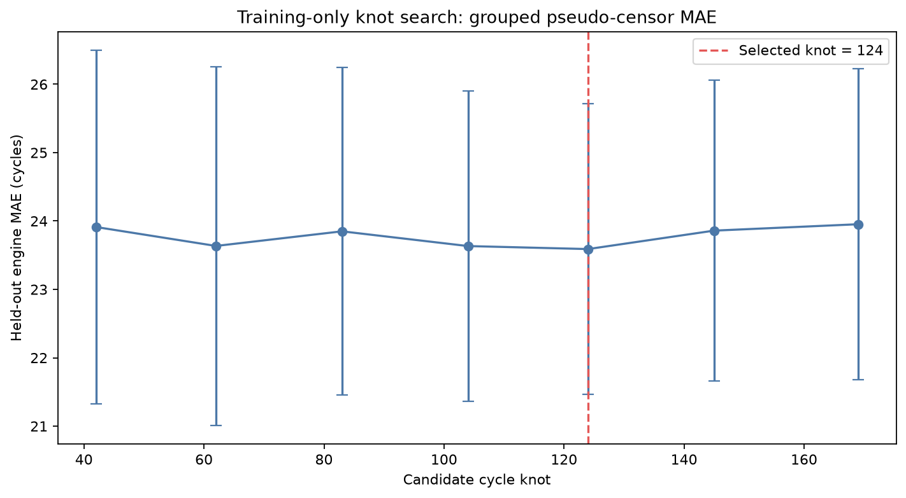

## Segmented PCA-XGBoost

Separate XGBoost regressors were fit for the two knot-defined segments. Each
segment used its own scaler/PCA transform, retaining at least 90% explained
variance, and 30 Adaptive Greedy Search (AGS) evaluations to minimize
engine-grouped pseudo-censor validation MAE. Final segment models were then fit
on the corresponding full segment training rows.

| Segment | Training rows | Test engines | PCA components | Best grouped-validation MAE |
|---|---:|---:|---:|---:|
| Early, cycle \(\leq124\) | 12,400 | 41 | 11 | 30.734 |
| Late, cycle \(>124\) | 8,231 | 59 | 9 | 14.263 |

The early segment's best AGS parameters were 100 estimators, depth 4, learning
rate 0.04, minimum child weight 1, subsample 0.85, column subsample 0.65,
L2 regularization 0.1, and gamma 0.75. The late segment's were 100 estimators,
depth 5, learning rate 0.15, minimum child weight 2, subsample 0.85, column
subsample 0.65, L2 regularization 2.0, and gamma 3.0.

### XGBoost performance

| Evaluation set | Segment | Rows | MAE | RMSE | R-squared |
|---|---|---:|---:|---:|---:|
| Apparent training fit (optimistic) | Early | 12,400 | 30.845 | 41.132 | 0.503 |
| Apparent training fit (optimistic) | Late | 8,231 | 11.299 | 16.897 | 0.847 |
| Engine-held-out pseudo-censor OOF | Early | 332 | 30.784 | 38.917 | 0.333 |
| Engine-held-out pseudo-censor OOF | Late | 268 | 14.267 | 23.208 | 0.660 |

| FD001 test metric | Result |
|---|---:|
| Engines | 100 |
| C-index | 0.832 |
| MAE | 20.045 cycles |
| RMSE | 26.803 cycles |
| R-squared | 0.584 |
| Median predicted RUL | 81.261 cycles |
| Median actual RUL | 86 cycles |

The lower early-segment validation accuracy compared with the late segment
indicates that short-cycle trajectories are harder to predict under this
setup. Apparent training metrics are included as fit diagnostics and are
optimistic; engine-held-out pseudo-censor metrics better indicate
generalization to unseen engines. The following diagnostics are descriptive and were not used as model-selection
criteria:

| Evaluation set | Shapiro residual normality p-value | Wilcoxon signed-error median-zero p-value | Spearman correlation of absolute error with prediction |
|---|---:|---:|---:|
| Engine-held-out pseudo-censor OOF | 1.623e-14 | 1.757e-14 | 0.5297 |
| Test engines | 0.3323 | 0.000608 | 0.5808 |

The OOF residuals depart from normality under the Shapiro test; the test-set
Shapiro test does not reject normality at the 0.05 level. Signed-error tests
indicate a nonzero median error in both sets, and absolute error is positively
associated with predictions in both sets. None of these tests is an
XGBoost assumption or a substitute for checking practical error size.

The survival comparison figures show empirical survival curves of the
100-engine test RUL distributions (actual labels versus predictions); they
summarize the distributions and are not individual engine survival forecasts.

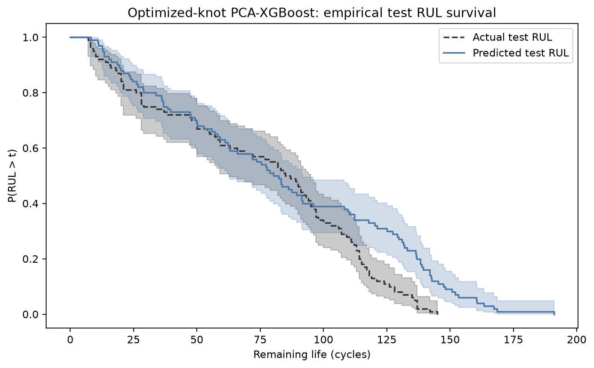

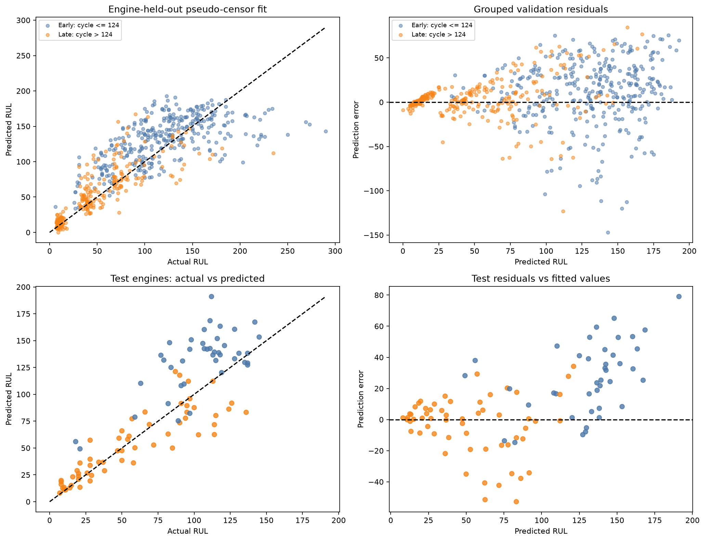

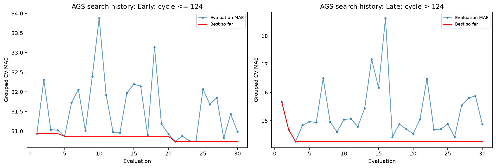

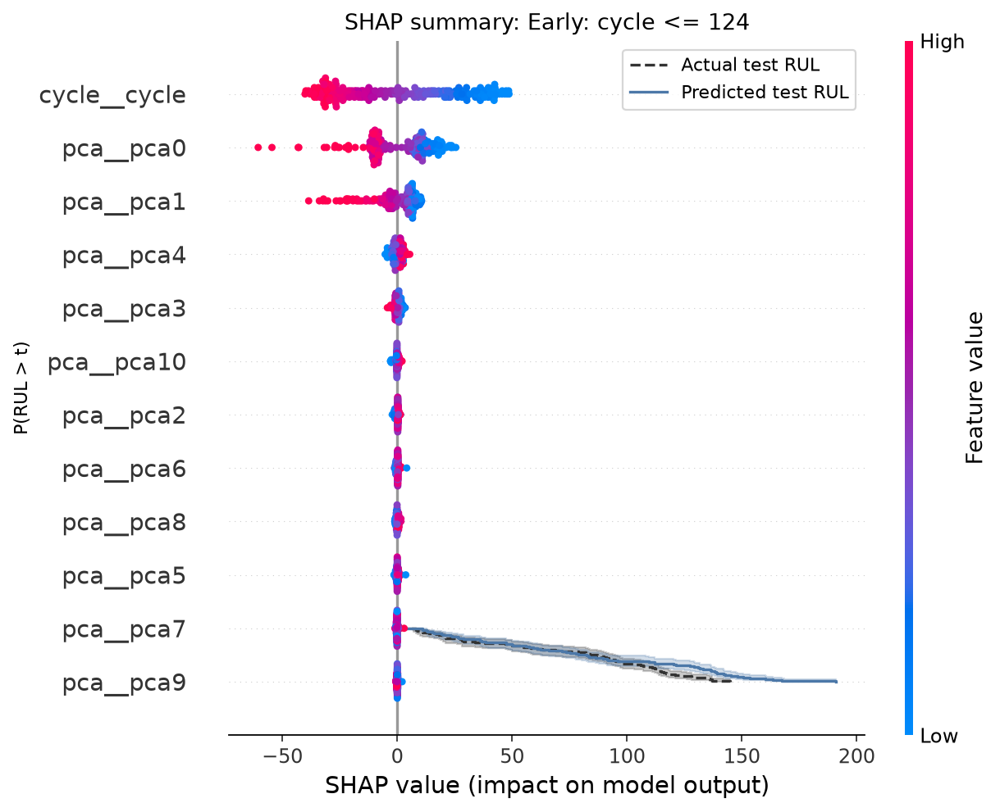

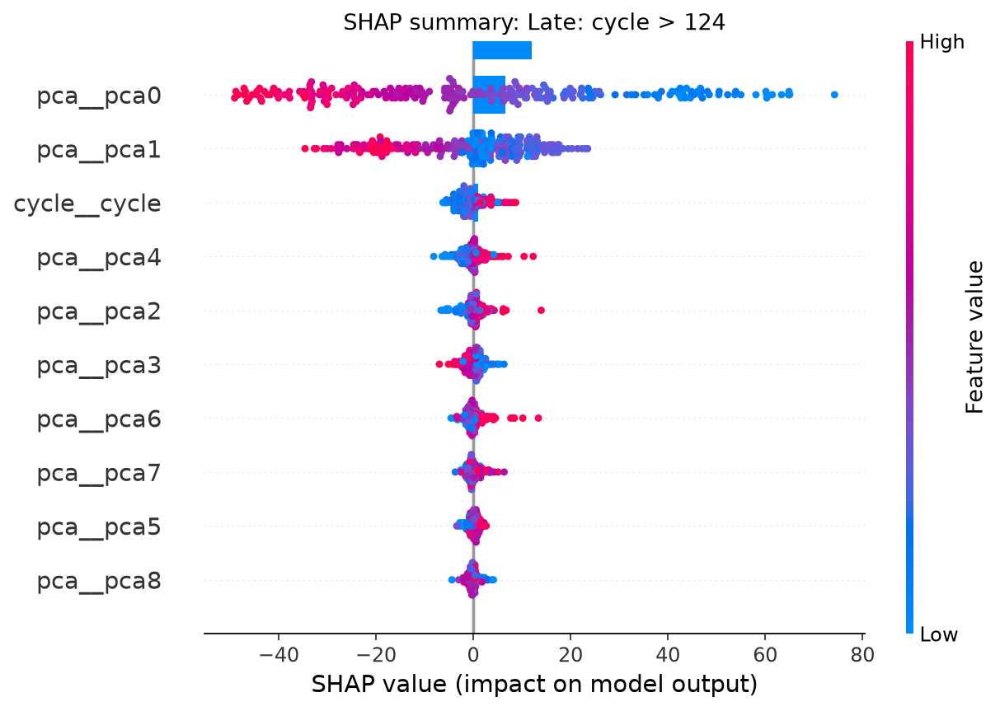

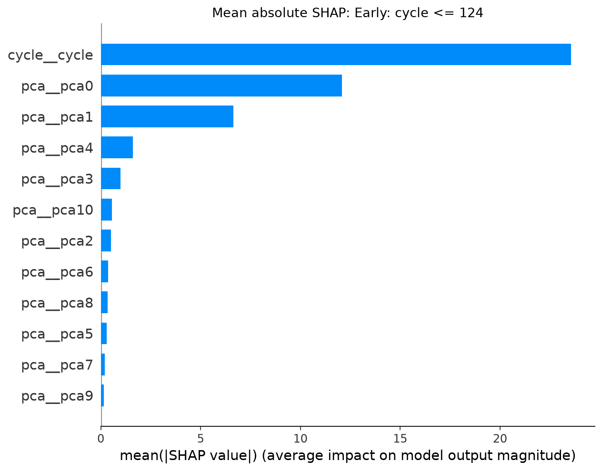

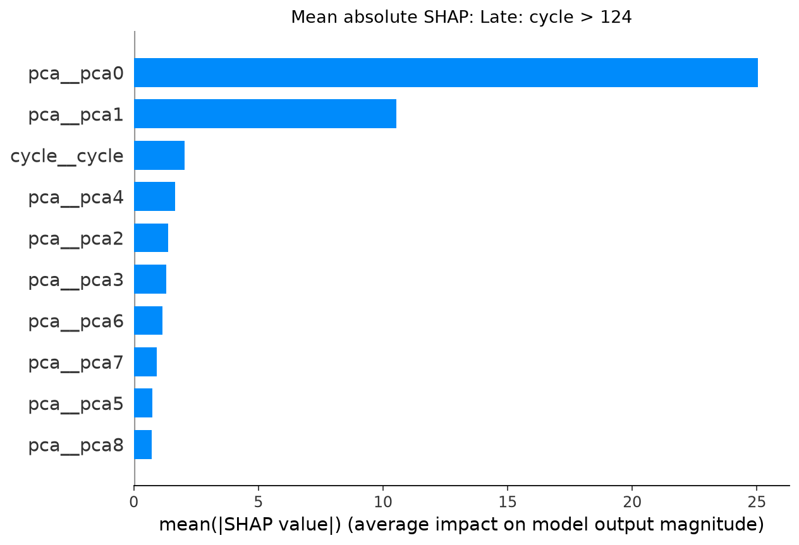

## Segmented SHAP-informed LSTM

The LSTM uses sliding sequences of length 15 and the segment-specific top-eight
SHAP-screened variables listed above, together with cycle. Training engines
were separated into 80 training engines and 20 validation engines; no engine
was shared across these partitions. Validation uses held-out pseudo-censor
windows. Target RUL was standardized for optimization, then predictions were
returned to cycle units. The segment models used early stopping (patience 8)
and selected epochs 9 (early) and 8 (late). Each segment's best epoch was
selected using its held-out validation partition before final training.

| Segment | Training rows | Best epoch | Apparent train MAE | Apparent train RMSE | Held-out validation rows / engines | Validation MAE | Validation RMSE | Validation R-squared |
|---|---:|---:|---:|---:|---:|---:|---:|---:|
| Early, cycle \(\leq124\) | 12,400 | 9 | 31.288 | 41.529 | 43 / 20 | 27.057 | 31.659 | 0.583 |
| Late, cycle \(>124\) | 8,231 | 8 | 14.348 | 22.109 | 37 / 19 | 11.425 | 18.078 | 0.724 |

| FD001 test metric | Result |
|---|---:|
| Engines | 100 |
| C-index | 0.836 |
| MAE | 19.178 cycles |
| RMSE | 26.162 cycles |
| R-squared | 0.604 |
| Median predicted RUL | 79.891 cycles |
| Median actual RUL | 86 cycles |

The validation and test MAE are both lower than the corresponding XGBoost
results, while the test C-index is 0.004 higher. Test residual normality
diagnostic Shapiro p=0.07097 (validation p=0.04438) is descriptive only; normal
residuals are not required for this LSTM. Per-segment validation sample sizes
are modest, so performance differences should not be overinterpreted.

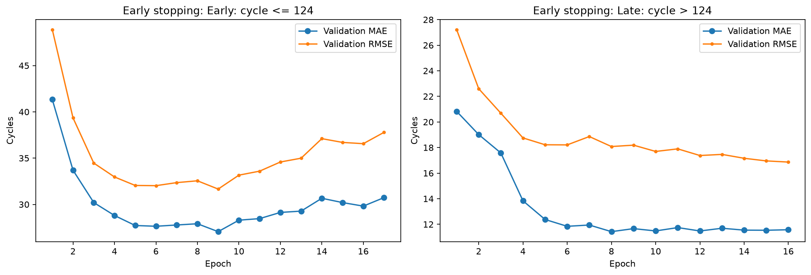

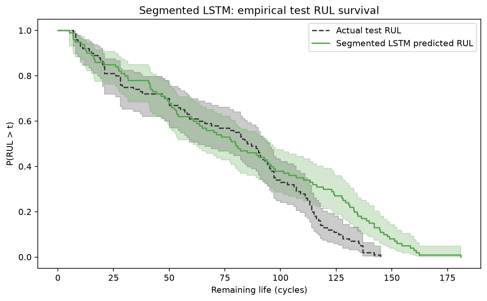

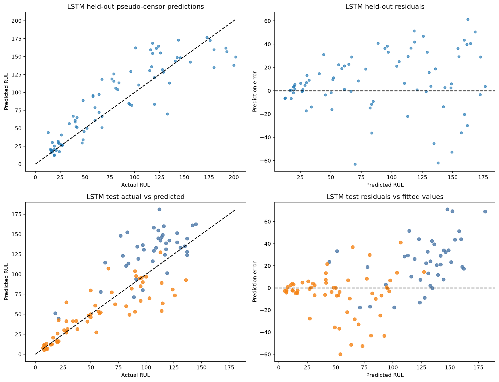

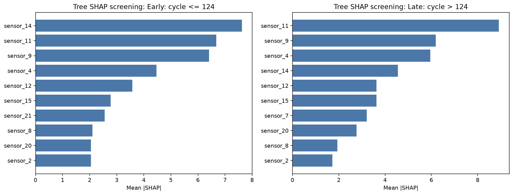

## Model comparison

All rows below use the same supplied FD001 test set of 100 engines. Lower MAE
and RMSE are better; higher C-index and R-squared are better. The fixed-Q0.25
metrics are from the preceding notebook experiment, not a separately rerun
validation benchmark.

| Model | Segmentation | C-index | MAE (cycles) | RMSE (cycles) | R-squared |
|---|---|---:|---:|---:|---:|
| Earlier PCA-XGBoost + AGS | Fixed Q0.25, cycle 52 | 0.839 | **18.264** | **25.625** | 0.620 |
| PCA-XGBoost + AGS + Tree SHAP | Selected knot, cycle 124 | 0.832 | 20.045 | 26.803 | 0.584 |
| SHAP-informed segmented LSTM | Selected knot, cycle 124 | **0.836** | 19.178 | 26.162 | **0.604** |

The LSTM improves over the optimized-knot XGBoost in these test metrics, but
neither new model improves on the prior fixed-Q0.25 model's MAE, RMSE, or
C-index. Thus, knot optimization did not translate to test improvement in this
comparison. This does not invalidate the knot-selection procedure; it shows
the training-only pseudo-censor criterion did not pick the best test-set
scoring split among all approaches examined.

## Limitations and interpretation

1. The supplied test set contains 100 engines from the same benchmark subset;
   this is not external or prospective validation.
2. The selected knot is the minimum over seven candidate quantiles and the
   specified pseudo-censor CV protocol. A different candidate grid or
   validation construction could select a different knot.
3. Training cycle rows are repeated within engines. The effective independent
   units are engines, not the 20,631 rows; grouped validation addresses this
   for tuning, while apparent in-sample fit is explicitly labeled optimistic.
4. The test-label metrics are reported after model selection and should be
   treated as descriptive benchmark results, not an unbiased estimate of
   performance after repeated experimentation.
5. SHAP indicates predictive attribution, not causal sensor effects. XGBoost
   SHAP for the PCA model is on components; LSTM inputs were selected using a
   separate tree surrogate.
6. This is a regression comparison. AIC/BIC are not appropriate for these
   XGBoost and LSTM prediction fits. C-index summarizes ranking, while MAE,
   RMSE, and R-squared summarize errors on the provided RUL labels.
7. No imputation, additional latent-factor model, or external statistical
   theorem was added as part of these experiments.
